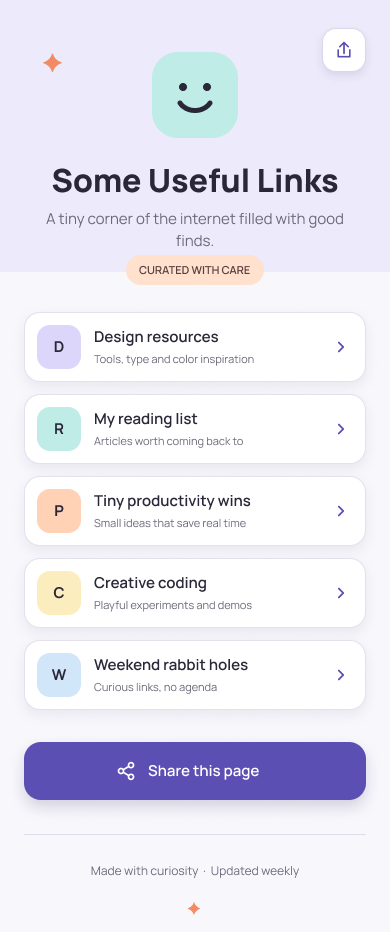
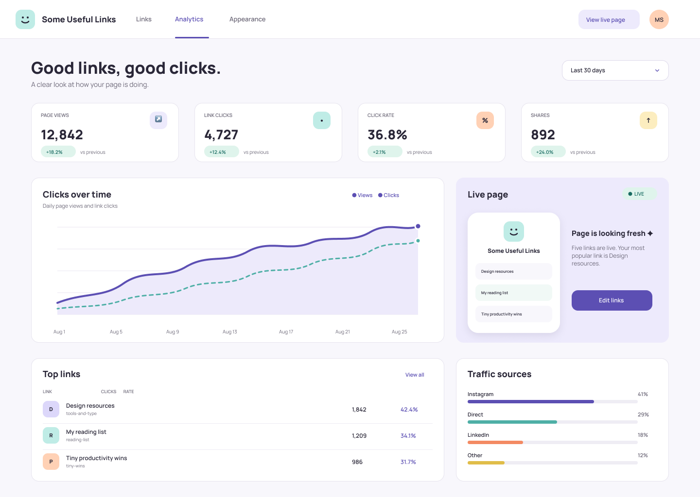
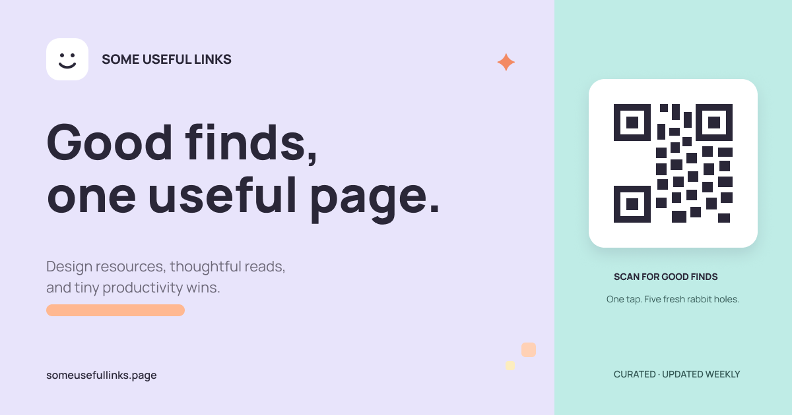

# Some Useful Links - Visual Design Specification

## Design Direction

"Some Useful Links" is a playful, mobile-first link page with the cleanliness
of Notion, the polish of Linear, and restrained pastel accents. The experience
should feel personal and inviting without becoming decorative or cluttered.

Core principles:

- Light, airy layouts with generous whitespace
- Clear hierarchy and short, friendly copy
- Rounded interactive elements with a shared radius system
- Pastel color accents balanced by dark, accessible text
- Subtle motion that never delays interaction
- One consistent visual language across visitor, analytics, and sharing views

## Color Palette

| Role | Color | Hex | Usage |
| --- | --- | --- | --- |
| Primary | Muted violet | `#5C4FB3` | Primary buttons, active tabs, chart lines, focus accents |
| Secondary | Light teal | `#BFECE6` | Logo, icon tiles, positive surfaces, social-card field |
| Lavender | Soft lavender | `#E8E4FB` | Header wash, selected surfaces, social-card background |
| Accent | Warm peach | `#FFB891` | Highlights, badges, decorative emphasis |
| Supporting accent | Soft yellow | `#FDEDBF` | Secondary icon tiles and chart accents |
| Page background | Lavender white | `#F8F7FC` | Main application background |
| Surface | White | `#FFFFFF` | Link rows, dashboard panels, modal surfaces |
| Primary text | Ink | `#2A2738` | Headings, labels, important values |
| Secondary text | Muted ink | `#6C6878` | Body copy, captions, metadata |
| Border | Pale violet gray | `#E5E2EC` | Panel and control borders |
| Positive text | Deep teal | `#186B61` | Positive trends and live status |
| Positive surface | Mint tint | `#DFF4EC` | Positive badges and status backgrounds |

Primary text, secondary text, primary buttons, and interactive states should
meet WCAG AA contrast requirements. Peach and yellow are supporting surfaces,
not body-text colors.

## Typography

Primary family: **Manrope**

Fallback stack:

```css
font-family: "Manrope", "DM Sans", system-ui, sans-serif;
```

| Style | Size | Weight | Line height | Usage |
| --- | ---: | ---: | ---: | --- |
| Social headline | 74px | 800 | 80px | 1200x630 social card |
| Dashboard title | 34px | 800 | 42px | Admin page heading |
| Mobile page title | 32px | 800 | 40px | Visitor identity |
| Section heading | 18px | 800 | 26px | Dashboard panels |
| Link label | 15px | 600 | 20px | Link-row title |
| Body | 14-15px | 400 | 22px | Descriptions and supporting copy |
| Button | 15px | 600 | 20px | Primary commands |
| Dashboard label | 12-13px | 600 | 18px | Navigation and controls |
| Caption | 10-12px | 400-600 | 16px | Metadata, chart labels, footers |

Letter spacing is `0`. Uppercase labels use font weight rather than expanded
tracking.

## Layout Specification

### Mobile Visitor Page

- Reference viewport: `390px`
- Horizontal page padding: `24px`
- Main content width: `342px`
- Header identity area: approximately `290px`
- Link-row height: `70px`
- Link-row gap: `12px`
- Primary share-button height: `58px`
- Footer starts after at least `32px` of separation
- Content is centered on wider mobile and tablet displays

### Tablet

- Breakpoint: `600px`
- Visitor content remains centered with a maximum width of `560px`
- Page padding grows to `32px`
- Dashboard cards may use a two-column layout
- Modal width is limited to the viewport minus `48px`

### Desktop

- Breakpoint: `1024px`
- Dashboard reference width: `1440px`
- Dashboard gutters: `64px`
- Grid gap: `24px`
- Maximum operational content width: `1312px`
- KPI row uses four equal columns
- Main analytics area uses an approximately `2:1` chart-to-preview ratio

## Spacing and Radius

Spacing follows a loose 4px base:

`4, 8, 12, 16, 24, 32, 48, 64`

Radius system:

- Small icon tile: `10-13px`
- Standard control: `13-14px`
- Link row and panel: `16px`
- Primary share button: `17px`
- Preview phone or modal: `22-24px`
- Circular avatar/status: `50%`

## Component Design

### Avatar and Logo

The identity mark is a rounded teal square containing a simple smiling face.
It avoids dependence on a personal photograph while still feeling friendly.

- Mobile size: `86x86px`
- Dashboard size: `40x40px`
- Mobile corner radius: `26px`
- Dashboard corner radius: `12px`
- Face color: `#2A2738`
- Background: `#BFECE6`

### Page Title

The title is centered below the logo on mobile. It uses Manrope ExtraBold,
32px, and the primary ink color. Supporting copy is limited to two short lines
and uses secondary text.

A peach "Curated with care" label separates the identity section from the
links without competing with the title.

### Link Buttons

Structure:

- `342x70px` on the reference mobile viewport
- White background
- `16px` radius
- 1px pale violet border
- 44px pastel icon tile
- Link title and one-line caption
- Right-aligned chevron
- Minimum touch target of 54px

States:

| State | Treatment |
| --- | --- |
| Default | White surface, subtle border and low shadow |
| Hover | Move up 2px, violet-tinted border, slightly stronger shadow |
| Active | Move down 1px, reduce shadow, deepen surface tint |
| Focus visible | 3px peach ring with 2px background separation |
| Visited | Keep text dark; soften the icon tile rather than recoloring text |
| Disabled | 55% opacity, no shadow, no translation |

### Analytics Dashboard

The analytics view uses the same logo, ink, lavender background, and pastel
accents as the visitor page. It is denser but not visually heavier.

Primary regions:

1. White navigation bar with Links, Analytics, and Appearance tabs
2. Page heading and date-range control
3. Four KPI panels: views, clicks, click rate, and shares
4. Clicks-over-time chart
5. Live page preview and edit action
6. Top-links table
7. Traffic-source bars

Panels use white surfaces, 16px corners, 1px borders, and little or no shadow.
Color is concentrated in icon tiles, trends, status, and data visualization.

### Share This Page Button

- Full content width on mobile
- `58px` height
- `17px` radius
- Violet fill `#5C4FB3`
- White share icon and label
- Shadow: violet-black at approximately 18% opacity

States:

- Hover: raise 2px and increase shadow
- Active: return to baseline and reduce shadow
- Focus: peach outer ring
- Generating: replace label with "Making your card..." and show a spinner
- Success: briefly show "Share card ready"

### Share Preview Modal

Desktop:

- Maximum width: `720px`
- White surface with `24px` radius
- Centered overlay with a translucent ink scrim
- Social image preview at 1200:630 aspect ratio
- Format selector, Download, Copy link, and Close controls

Mobile:

- Full-screen sheet
- Preview remains above actions
- Sticky bottom action area
- Safe-area padding is respected

### Footer

The visitor footer contains:

- A subtle divider
- "Made with curiosity - Updated weekly"
- One small peach sparkle mark

It should remain quiet and never compete with the share button.

## Interaction and Animation

### Entrance

- Header fades in and moves upward by 8px over 300ms
- Link rows enter with a 45ms stagger
- Dashboard KPI panels fade in as one group
- Charts animate only after their panel is visible

### Transitions

- Hover and focus transitions: `160-200ms ease-out`
- Modal entrance: `220ms ease-out`
- Scrim fade: `180ms`
- Chart line reveal: `500ms ease-out`

### Micro-interactions

- The smiling logo may tilt by 2 degrees on hover
- Link chevrons move 3px to the right on hover
- Positive KPI badges briefly brighten when values refresh
- Copy-link success uses a short checkmark transition

Under `prefers-reduced-motion`, remove translation, tilt, staggering, and chart
draw animations. Keep simple opacity changes.

## Social Share Image

Canvas: `1200x630px`

Composition:

- Lavender field across the left 70%
- Light teal field across the right 30%
- Logo and small brand label in the upper-left
- Large two-line headline in the left center
- Short descriptive tagline below the headline
- Peach underline accent
- Large QR code in a white 256px container
- URL in the lower-left
- "Curated - Updated weekly" in the lower-right

All important content stays at least 64px from the outer edge. The QR code has
a generous white quiet zone and remains readable in reduced social previews.

The generated production QR code should point to the canonical public page
URL. The sample design uses a visual placeholder.

## Screen States

### Default Visitor View

- Branded identity header
- Five visible link rows
- Primary share action
- Quiet footer
- No analytics or management controls

Loading state:

- Preserve all final dimensions
- Replace link text with soft neutral skeleton bars
- Do not resize rows while loading

Empty state:

- Keep the identity header
- Show one friendly message and a refresh action
- Do not display an empty stack of bordered rows

Error state:

- Keep cached links when available
- Show a compact peach-tinted status message

### Analytics Admin View

- Analytics tab selected
- Date-range control visible
- KPI, chart, preview, links, and source data populated

Loading state:

- Use fixed-size skeletons inside the existing panel geometry
- Chart axes remain visible to prevent layout shift

No-data state:

- KPI values display zero
- Chart becomes a quiet baseline
- Top-links panel explains that results appear after visits

### Share Image Generation

Generating:

- Modal opens immediately
- Preview area displays a lavender shimmer
- Download is disabled

Success:

- Final card replaces the shimmer
- Download and Copy link become active
- A small teal confirmation appears

Error:

- Keep the modal open
- Show an inline error beneath the preview
- Provide Retry and Copy page link actions

## Sample Screens

### Link Page



### Analytics Dashboard



### Social Card



## Source Design

The editable Figma source is available here:

[Open Some Useful Links in Figma](https://www.figma.com/design/UFKQkIljwfvIUMCgx0jZtu)
